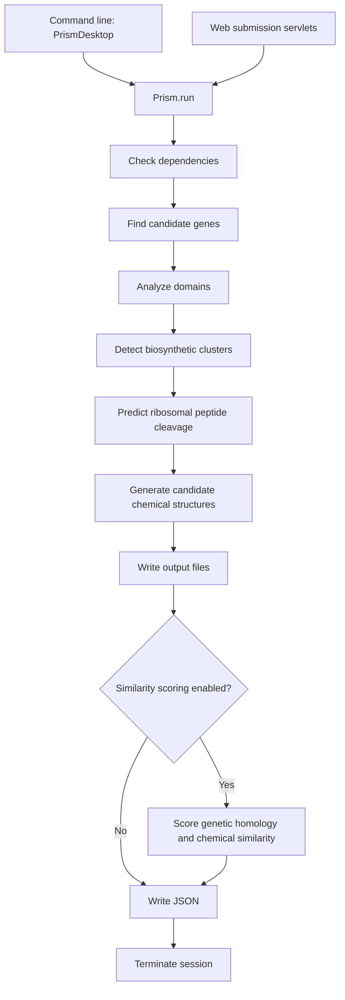
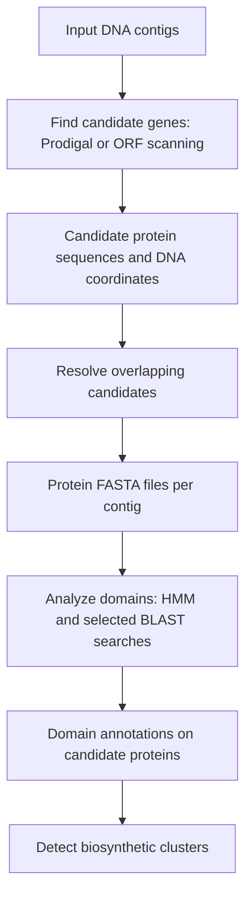

# PRISM research notes

Selected findings and decisions from our conversations. This file uses Markdown
with fenced Mermaid diagrams; it is not a standalone Mermaid diagram source.

## 2026-10-11 — Project structure inspection

PRISM predicts natural product biosynthetic gene clusters and candidate chemical
structures from genomic sequences. The repository contains approximately 400 Java
source files and supports command-line and Tomcat web execution.

### Main locations

| Location | Role |
| --- | --- |
| `prism/src/ca/mcmaster/magarveylab/prism/Prism.java` | Shared analysis pipeline |
| `prism/src/ca/mcmaster/magarveylab/prism/PrismDesktop.java` | Command-line entry point |
| `prism/src/ca/mcmaster/magarveylab/prism/web/` | Submission servlets, configuration, reports, and graphs |
| `prism/src/ca/mcmaster/magarveylab/prism/data/` | Genome, contig, gene, cluster, and chemical structure models |
| `prism/src/ca/mcmaster/magarveylab/prism/cluster/` | Cluster detection, annotation, reactions, and scaffold generation |
| `prism/src/ca/mcmaster/magarveylab/prism/combinatorialization/` | Candidate assembly and reaction permutations |
| `prism/src/ca/mcmaster/magarveylab/prism/orfs/` | Gene prediction and Prodigal integration |
| `prism/src/ca/mcmaster/magarveylab/prism/genome/` | HMM-based domain searches |
| `prism/src/ca/mcmaster/magarveylab/prism/blast/` | BLAST searches and parsing |
| `prism/src/ca/mcmaster/magarveylab/prism/motif/` | Motif searches and peptide cleavage prediction |
| `prism/src/ca/mcmaster/magarveylab/prism/homology/` | Gene cluster homology |
| `prism/src/ca/mcmaster/magarveylab/prism/tanimoto/` | Chemical fingerprint similarity |
| `prism/WebContent/` | Web assets, reference data, tool scripts, and dependency test fixtures |
| `prism/lib/` | Bundled Java dependencies |
| `prism/pom.xml` | Maven build targeting Java 7 and WAR packaging |

### Execution flow

The sequence below follows `Prism.run()`. Similarity scoring runs only when
`config.score` is enabled.



## Module 1 — Find candidate genes

This is the stage previously labeled "Predict genes." Its purpose is to turn
input DNA into candidate protein-coding regions and their translated proteins.
"Scan for ORFs" describes the built-in scanning method; "Find candidate genes"
covers both that method and Prodigal prediction.

### Input and terminology

- The input file contains DNA and may contain multiple contigs. A contig is a
  continuous stretch of DNA.
- A codon is a group of three DNA bases interpreted during translation.
- An open reading frame (ORF) is a stretch that can be read as codons without an
  intervening in-frame stop codon. Candidate complete coding regions typically
  have a start and a stop codon; partial regions may reach a sequence boundary.
- An ORF is a candidate coding region, not confirmation of a real gene.

The DNA sequence is fixed, but its interpretation can vary. Each strand has
three reading frames, giving six frames across the forward strand and reverse
complement. Different start and stop positions can produce multiple candidates,
including overlapping alternatives.

```text
DNA:     ATGAAAGGCTAA...
Frame 1: ATG | AAA | GGC | TAA | ...
Frame 2:  TGA | AAG | GCT | AA...
Frame 3:   GAA | AGG | CTA | A...
```

### Processing

1. Read FASTA or GenBank input into a `Genome` with its contigs. The entry point
   also checks the input file size; `OrfSearch` applies a contig-count limit.
2. Find candidates using the configured methods:
   - **Prodigal:** run the external gene predictor and import its protein
     sequences, coordinates, strand, and partial-prediction flags. PRISM selects
     `single` mode when the longest contig exceeds 500,000 bases, otherwise
     `meta` mode. A handled Prodigal failure enables built-in ORF scanning.
   - **Built-in scanning:** clean the sequence, examine both strands, look for
     `ATG`, `GTG`, or `TTG` starts, and advance in steps of three to find `TAA`,
     `TAG`, or `TGA` stops. Completed candidates pass a length check
     (`stop position - start position > 60`); sequence-boundary candidates have
     separate handling. Translate candidate DNA into amino acids.
3. Store candidates as `Orf` objects associated with their source contigs.
4. Resolve certain overlaps on the same strand and in the same reading frame.
   The rules favor complete Prodigal predictions over partial ones and Prodigal
   predictions over built-in scan results; they do not remove every overlap.
5. Write retained protein sequences to a FASTA file for each contig with ORFs.
   For FASTA input, also set organism information from the input header.

### Output and FASTA format

The output includes candidate objects with identifiers, DNA start/end positions,
strand, protein sequence, and prediction method. Prodigal candidates also carry
partial-prediction flags. The coordinates remain in the objects; the protein
FASTA files provide the sequences for downstream searches.

These are **candidate protein sequences, predicted to be complete or partial**.
A prediction marked complete appears to cover an entire coding region; this
does not confirm that it is a real gene, that its boundaries are correct, or
that the protein is actually produced. Partial predictions can arise when a
gene extends beyond an input contig boundary. Sequence completeness and
confidence that a candidate is biologically real are separate questions.

FASTA is a plain-text sequence format. Each entry begins with a `>` header,
followed by sequence letters. FASTA can represent DNA, RNA, or proteins; these
downstream files contain proteins, using one-letter amino acid codes.

```fasta
>orf_00001
MKAIGL
>orf_00002
MVLSPAD
```

One input DNA file can therefore yield many protein sequences. They derive from
different candidate regions, strands, or frames of the input contigs. They
usually represent different potential genes, though some can be alternatives.

### Code locations

- Entry point: [`Prism.findOrfs()`](prism/src/ca/mcmaster/magarveylab/prism/Prism.java).
- Orchestration, overlap handling, and built-in scanning:
  [`OrfSearch`](prism/src/ca/mcmaster/magarveylab/prism/orfs/OrfSearch.java),
  especially `run()`, `removeOverlap()`, `scanForOrfs()`, and `scanFrameForOrfs()`.
- External predictor integration:
  [`ProdigalSearch`](prism/src/ca/mcmaster/magarveylab/prism/orfs/ProdigalSearch.java).

## Module 2 — Analyze domains

This stage takes the candidate proteins and identifies recognizable protein
families and functional regions (domains). It provides evidence about what the
proteins may do, particularly their roles in biosynthesis.

### HMM and BLAST searches

Both searches belong to this module, after candidate gene finding.

| Method | Compares candidates against | Typical result |
| --- | --- | --- |
| HMM search | A statistical model of a protein family or domain | Domain/family match, location, and score |
| BLAST search | Individual reference sequences | Similar sequences, aligned regions, and scores |

HMM means Hidden Markov Model. A protein-family HMM captures amino acid patterns
and allowed variation, including insertions and deletions, across related
sequences. A match may indicate that part of a candidate is a ketosynthase
domain. BLAST instead finds local sequence similarities, for example to a
reference protein with a known annotation.

`GenomeSearch.run()` coordinates substrate, prerequisite, other thiotemplated,
type II polyketide, tailoring, sugar, resistance, ribosomal, and regulator
searches, with some controlled by configuration. Selected domains undergo
additional BLAST analysis. It also invokes optional ribosomal-sequence detection
and resolves domain overlaps.

The resulting annotations associate detected domains and their locations with
the candidate proteins. The next module uses this information to detect
biosynthetic gene clusters. A match supports a functional interpretation; it
does not prove it. A missing match can also reflect a novel or poorly
characterized protein.

### Output: annotated candidate proteins

Module 2 enriches the existing candidate proteins (`Orf` objects) with domain
annotations rather than producing a new set of protein sequences. Each detected
domain records its type or family, its location within the protein sequence,
and match-scoring evidence. Domain assignments support interpretations of
likely biosynthetic roles; supported searches can also provide substrate-related
predictions or further BLAST-based annotations.

```text
Input:  ORF 1 → candidate amino acid sequence

Output: ORF 1 → [domain A][domain B][domain C]
                positions, scores, inferred roles
```

A candidate protein can have multiple detected domains or none. Missing domain
annotations do not by themselves establish that the candidate is not a real
protein. The original protein sequence and source DNA coordinates remain
associated with the ORF. Module 3 combines these annotations with DNA positions
to group nearby candidate biosynthetic genes into clusters.

### From protein sequences to enzyme functions

"Find candidate genes" already produces candidate amino acid sequences. Domain
analysis assigns likely families and functions to those sequences; it does not
turn them into protein sequences for the first time. A candidate may encode an
enzyme, regulator, transporter, or another kind of protein.

Matches can cover only part of a protein. Even a complete candidate protein can
contain several domains, with a search recognizing one region at a time:

```text
Candidate protein: [ region A ][ enzyme domain ][ region B ]
                                      |
                              matches a domain family
```

A partial protein can also yield a useful annotation if enough of a relevant
domain remains. A regional match supports the domain assignment and may suggest
the broader protein's role, but it does not necessarily establish its exact
substrate or reaction.

PRISM infers these annotations from amino acid sequences using HMM and BLAST
searches. It does not need to determine the proteins' three-dimensional
structures. Actual protein behavior also depends on folding, modifications,
interactions, and cellular conditions; these searches do not establish all of
those properties.

### Recognition versus discovery

Domain analysis primarily annotates candidates using existing knowledge: its
HMM models and reference sequences represent known families and previously
characterized or annotated proteins. It cannot by itself establish an entirely
new enzyme family or a previously unknown biochemical activity.

It can nevertheless recognize a previously uncharacterized protein as a new
candidate member of a known family, or reveal an unusual combination of known
domains. A familiar family can also contain enzymes with different substrates
or activities, so a family match does not guarantee an exact biochemical
function.

Weak or missing matches can flag candidates for further investigation, but do
not establish novelty: they can also result from incomplete sequences,
prediction errors, or limited reference coverage. Establishing a new family or
activity requires additional evidence; confirming biochemical activity usually
requires experiments.

### Contributions of later modules

| Module | Contribution to interpreting enzymes and products |
| --- | --- |
| Find candidate genes | Identifies possible coding regions and obtains candidate protein sequences. |
| Analyze domains | Provides the main sequence-based evidence for enzyme families and likely activities. |
| Detect biosynthetic clusters | Groups genes into biosynthetic context using their annotations and genomic locations. |
| Generate candidate chemical structures | Uses biosynthetic annotations to model possible reactions and small-molecule products. |

In the pipeline diagram, **chemical structures are candidate small molecules
produced by the biosynthetic machinery**, not the three-dimensional structures
of the enzymes themselves.

The conceptual chain is therefore:

**DNA → candidate protein sequences → domain matches → inferred enzyme
activities → candidate biosynthetic products.**

### Role of existing biological knowledge

Gene prediction models and reference databases provide complementary evidence:
gene predictors use coding patterns to identify likely genes, while sequence
and family comparisons help interpret the resulting proteins. General examples
include UniProt and NCBI RefSeq for reference proteins, and Pfam and InterPro for
protein families and domains. These examples do not imply that this PRISM
checkout directly queries all of those resources; its code uses its configured
HMM libraries and BLAST databases.

### Code locations

- Entry point: [`Prism.analyzeOrfs()`](prism/src/ca/mcmaster/magarveylab/prism/Prism.java).
- Search orchestration:
  [`GenomeSearch.run()`](prism/src/ca/mcmaster/magarveylab/prism/genome/GenomeSearch.java).
- Individual domain HMM searches:
  [`DomainSearch.run()`](prism/src/ca/mcmaster/magarveylab/prism/genome/DomainSearch.java).



## Module 3 — Detect biosynthetic clusters

This stage asks which nearby candidate genes may work together to make a
natural product. It uses the DNA coordinates from gene finding and the domain
annotations from domain analysis.

### What a biosynthetic gene cluster represents

A biosynthetic gene cluster is a group of nearby **genes**, whose encoded
proteins collectively contribute to producing a molecule. These can include
core enzymes that build a backbone, additional enzymes that modify it, and
proteins involved in regulation, transport, or resistance. This biological
definition does not mean PRISM necessarily includes every such gene in its
detected cluster.

For many specialized natural products, particularly in bacteria and fungi,
biosynthetic genes occur close together on the DNA. This organization makes
proximity useful evidence for a shared pathway. It is not universal: genes
participating in a pathway can also be dispersed across the genome. Proximity
alone does not establish that genes work together.

```text
DNA:      [gene A] — [gene B] — [gene C]
              ↓          ↓          ↓
           enzyme A   enzyme B   enzyme C

Pathway: starting material → intermediates → product
```

### Processing in this implementation

1. Process each contig separately, starting candidate groups from ORFs with
   biosynthetic domains.
2. Greedily add unassigned ORFs with detected domains when their coordinates
   meet the distance checks against the current region, using `config.window`.
   Added biosynthetic ORFs can extend the region used for these checks. This is
   a heuristic grouping procedure, not a reconstruction of every possible
   pathway.
3. Identify biosynthetic modules within the grouped proteins. Here a module is
   a functional grouping of protein domains, distinct from a software module.
4. Check module relationships, starter machinery, substrate prerequisites,
   and other supported biosynthetic features.
5. Look for putative ribosomal peptide precursors, assign ORF types and cluster
   orientation, infer possible sugar combinations, and assign cluster types.
6. Remove precursor assignments inappropriate for the inferred cluster type
   and retain candidate clusters with at least one recognized type.

### Output

The output is annotated `Cluster` objects attached to their source contigs.
They contain grouped ORFs and inferred biosynthetic properties, supporting
later precursor-cleavage and chemical-product predictions. A detected cluster
is a prediction that the genes contribute to related biosynthesis, not
experimental confirmation of a shared pathway or product.

### Limits: dispersed genes and fragmented input

PRISM can miss a pathway or capture only part of it when relevant genes are
far apart or occur on different contigs:

- Genes outside the grouping window can be excluded or assigned to separate
  candidate clusters; intervening biosynthetic genes can extend a group.
- Genes on different contigs are not joined into one cluster by this code.
- A genuinely dispersed pathway and an assembly that splits a physically
  nearby gene group across contigs can both prevent complete grouping.

Domain analysis may still annotate individual proteins in these cases, but
cluster detection may not connect them into the complete pathway. Consequently,
downstream product predictions can be incomplete or unavailable.

### Code locations

- Entry point: [`Prism.findClusters()`](prism/src/ca/mcmaster/magarveylab/prism/Prism.java).
- Grouping and orchestration:
  [`ClusterFinder.cluster()`](prism/src/ca/mcmaster/magarveylab/prism/cluster/ClusterFinder.java).
- Supporting interpretation:
  [`ClusterAnalyzer`](prism/src/ca/mcmaster/magarveylab/prism/cluster/analysis/ClusterAnalyzer.java)
  and [`ModuleFinder`](prism/src/ca/mcmaster/magarveylab/prism/cluster/module/ModuleFinder.java).

## Module 4 — Predict ribosomal peptide cleavage

This stage predicts which part of a ribosomal precursor peptide remains after
biological processing removes its leader region. It applies to supported
RiPPs: ribosomally synthesized and post-translationally modified peptides.
It does not cut every enzyme protein in a biosynthetic cluster.

### Biological role of cleavage

Cleavage is a natural process in which enzymes cut peptide bonds at particular
positions. Many RiPP precursors contain a leader region that helps guide
processing and a core region that supplies the sequence of the product.
Leader removal and chemical modification of the core contribute to maturation;
their order varies by pathway.

```text
Precursor: [ leader region ][ core peptide ]
                            ↑
                   predicted cleavage site

Retained:                  [ core peptide ]
```

This is a simplified layout; processing rules differ between peptide families.
PRISM predicts the biological processing computationally. A retained sequence
is not necessarily the final chemically modified product.

### What a pathway means

A biosynthetic pathway is a connected series of biological reactions that
converts starting materials into a product, with enzymes carrying out individual
steps. Pathways can branch or involve multiple starting materials.

```text
Starting material → Intermediate A → Intermediate B → Product
                  enzyme 1        enzyme 2         enzyme 3
```

A pathway describes reactions; a gene cluster describes nearby genes on DNA
encoding proteins involved in biosynthesis. A pathway's genes can occur in a
cluster or be dispersed across the genome.

### How PRISM predicts the cleavage point

PRISM uses a local library of precursor sequence motifs together with
family-specific rules. A motif is a recognizable amino acid pattern associated
with a biological feature. Here, motif matches provide evidence about precursor
processing; they are not direct observations of a cut.

1. Obtain candidate precursor peptides identified in the cluster.
2. Select a predictor based on the precursor's annotated type, such as a lasso
   peptide or lantipeptide precursor. If no predictor is available, skip it.
3. Invoke the predictor's motif-search step. The shared implementation selects
   motifs associated with that RiPP family and uses FIMO to locate matches.
4. Apply the family-specific rules to infer cleavage positions and retained
   sequences. The motif position and cleavage position need not be identical;
   predictors can use offsets and heuristics.
5. Generate candidate retained peptides as `Propeptide` objects. Multiple
   candidates may be generated when the rules admit alternatives. These support
   downstream chemical-structure predictions.

For example, the lasso peptide predictor uses an offset from the best motif
match to select a retained sequence. For putative lasso precursors, it instead
has a heuristic route using the annotated domain start.

The motif library and coded rules act as the prediction knowledge base.
Coverage depends on the supported precursor families and patterns. Missing or
ambiguous matches can produce absent or uncertain predictions; experimental
evidence would be needed to confirm the actual biological cleavage site.

### Code locations

- Pipeline entry point: `Prism.cleaveRibosomalPrecursors()` in
  [`Prism.java`](prism/src/ca/mcmaster/magarveylab/prism/Prism.java).
- Precursor iteration and predictor selection:
  [`RibosomalPrecursorCleaver.cleave()`](prism/src/ca/mcmaster/magarveylab/prism/cluster/analysis/RibosomalPrecursorCleaver.java).
- Mapping precursor types to predictors:
  [`LeaderPredictors`](prism/src/ca/mcmaster/magarveylab/prism/enums/LeaderPredictors.java).
- Shared motif selection and searching:
  [`AbstractLeaderPredictor`](prism/src/ca/mcmaster/magarveylab/prism/motif/AbstractLeaderPredictor.java)
  and [`FimoSearch`](prism/src/ca/mcmaster/magarveylab/prism/motif/FimoSearch.java).
- Example family-specific rules:
  [`LassoPeptidesPredictor`](prism/src/ca/mcmaster/magarveylab/prism/motif/leadercleavage/LassoPeptidesPredictor.java).

### Output and relationship to products

Module 4 produces candidate retained amino acid sequences as `Propeptide`
objects, with start/end positions in the precursor and motif evidence where
provided by the predictor. Predictors attach these candidates to their parent
ORFs. A precursor may yield multiple alternatives or no candidate.

For supported RiPP pathways, the retained peptide supplies the product's
starting backbone. It is **material that becomes the product**, rather than an
enzyme that makes the product. Module 5 models chemical modifications to that
backbone. Alternative cleavage candidates can lead to alternative products;
they are not generally all combined into a single product.

These candidates can be understood as predicted peptide intermediates for
product modeling, not confirmed biological intermediates. In the cell, some
modifications may precede cleavage, so the computational stage order should
not be interpreted as a universal biological reaction order.

### Invocation versus conditional processing

`Prism.run()` always calls `cleaveRibosomalPrecursors()` before
`generateScaffolds()` during normal execution. There is no top-level branch
that bypasses the Module 4 call for non-RiPP clusters.

Within the cleavage stage, `RibosomalPrecursorCleaver.cleave()` loops over
`RibosomalPrecursorAnalyzer.getPrecursors(cluster)`. If that list is empty,
there is no cleavage prediction. If a precursor lacks a matching predictor in
`LeaderPredictors`, it is skipped with `continue`.

Thus, **Module 4 is always invoked, but performs cleavage prediction only for
identified ribosomal precursors with supported predictors. Other clusters
proceed to Module 5 without cleavage processing.** Calling Module 4 a "branch"
describes its biological applicability, not the actual top-level control flow.
An exception can still interrupt the pipeline; this describes normal execution.

## Module 5 — Generate candidate chemical structures

This stage adds chemical construction logic to the annotations and precursor
predictions. It builds candidate small-molecule structures using encoded
building-block mappings, biosynthetic rules, and reaction implementations.
It is not merely a visualization of earlier outputs or a physical simulation
that proves which product the organism makes.

### Input and output

| | Contents |
| --- | --- |
| Input | Annotated clusters containing grouped ORFs, detected domains, inferred biosynthetic modules, substrate predictions, and other cluster properties. For supported RiPPs, these also include Module 4's candidate retained peptides attached to their parent ORFs. |
| Output | A `Library` of candidate `Scaffold` objects associated with each cluster. Each scaffold represents a predicted molecular structure (atoms and bonds) constructed under an assembly and reaction plan. |

```text
Annotated cluster + retained peptides where applicable
                         ↓
            Build and modify molecular structures
                         ↓
           Library of candidate chemical products
```

A cluster may yield multiple structures because of alternative assembly orders,
cleavage candidates, or reaction choices. It may yield no structure if prediction
fails or supported rules are insufficient. The outputs are candidate chemical
products, not confirmed molecules or protein three-dimensional structures.
They provide the structures used by downstream chemical similarity scoring.

### Different pathway types use different starting material

PRISM supports multiple biosynthetic families, not every biological pathway.
Its coverage depends on its domain models, precursor predictors, and supported
chemical construction and reaction rules.

| Pathway type | How the product backbone originates | Relationship to Module 4 |
| --- | --- | --- |
| RiPPs | A gene encodes a precursor peptide, which is processed and modified by other proteins. | Candidate retained peptides supply backbones for supported product predictions. |
| Nonribosomal peptides (NRPs) | Enzyme machinery assembles amino acid building blocks without ribosomal translation of the product chain. | Precursor cleavage is not used to build this backbone. |
| Polyketides | Enzyme machinery assembles and modifies carbon-based building blocks. | Precursor cleavage is not used to build this backbone. |
| Hybrids, such as NRP–polyketide systems | Combine different biosynthetic assembly machinery. | Processing depends on the components; cleavage is not a universal requirement. |

For RiPPs, a gene directly encodes the peptide material that becomes the
product, while other genes encode processing enzymes. For NRPs and polyketides,
genes encode machinery that assembles the product from separate building blocks.
Detecting a cluster does not guarantee that PRISM supports enough of its
chemistry to predict the complete product.

### Additional processing

1. Generate possible biosynthetic module assembly orders using
   `ClusterPermuter.getModulePermutations()`.
2. Generate combinatorial plans for assembly, tailoring reactions, and
   cyclization using `CombinatorialPlanGenerator.generateAllPlans()`.
3. Construct a backbone from the ordered modules. `StructureGenerator` uses a
   separate construction route for type II polyketides; its general route
   creates and extends a linear scaffold from the modules.
4. Apply reaction plans in priority order, changing the molecular structure
   according to supported inferred activities.
5. Apply the plan's supported cyclization pattern, potentially forming rings
   by adding bonds between selected atoms.
6. Collect generated candidate scaffolds into a library. Alternative plans
   can yield multiple possible products rather than one uniquely determined
   molecule.

```text
Cluster annotations and, where applicable, retained peptide candidates
                              ↓
                 Assembly and reaction plans
                              ↓
             Build backbone → modify → form rings
                              ↓
                 Candidate chemical structures
```

A group of enzymes can collectively produce a molecule through a pathway,
with individual enzymes building, modifying, or processing intermediates.
One group can also produce multiple related products. PRISM predicts candidates
from the inferred activities; it does not experimentally confirm those products.

### Code locations

- Pipeline entry point: `Prism.generateScaffolds()` in
  [`Prism.java`](prism/src/ca/mcmaster/magarveylab/prism/Prism.java).
- Assembly-plan generation and candidate library construction:
  [`LibraryGenerator`](prism/src/ca/mcmaster/magarveylab/prism/cluster/scaffold/LibraryGenerator.java).
- Backbone construction, reaction execution, and cyclization:
  [`StructureGenerator`](prism/src/ca/mcmaster/magarveylab/prism/cluster/scaffold/StructureGenerator.java).

## Module 6 — Score genetic homology and chemical similarity

This optional stage compares detected clusters and predicted chemical products
with references. It provides context about similarity to known biosynthesis;
it does not construct the products or experimentally confirm their identities.

### Genetic homology scoring

This comparison asks whether a detected cluster resembles a known biosynthetic
gene cluster. Here, "genetic" does not mean simply comparing raw DNA:
`HomologousClusterSearch` runs protein-sequence identity searches and a
domain-based comparison against PRISM's reference clusters.

It initializes reference-cluster records from local BLAST databases in
`identityFasta`, runs identity searches using the cluster's `scaffoldOrfs`
file, and assigns domain comparison scores and coverage. Reference matches are
stored in `cluster.homologs()` and sorted using domain, average-domain, and
identity scores. These similarity measurements provide evidence for relatedness;
they are not direct proof that two clusters produce the same molecule.

### Chemical similarity scoring

This comparison asks whether predicted product structures resemble known
small molecules. PRISM generates ECFP6 and FCFP6 fingerprints: encoded sets of
molecular features. It retrieves reference molecules and fingerprints from a
database and calculates Tanimoto coefficients for predicted/reference pairs.

For binary fingerprints, the coefficient measures shared features relative to
all features present in either fingerprint:

```text
Tanimoto = shared features / features present in either fingerprint
```

A score of 0 indicates no shared fingerprint features; a score of 1 indicates
identical fingerprints. Identical fingerprints do not necessarily establish
identical molecular structures. Scores depend on the fingerprint representation
and are not probabilities that a predicted product is correct.

`TanimotoSearch` calculates both ECFP6 and FCFP6 coefficients, sorts results by
ECFP6 similarity, and attempts to truncate the list to the top 100. Results are
added to `cluster.scores()`. The implementation connects to a local Neo4j
database endpoint; the class describes its reference resource as BIRD.

### Invocation, outputs, and limits

- `Prism.run()` calls `score()` only when `config.score` is enabled.
- `score()` runs cluster homology scoring, then chemical similarity scoring.
- Chemical scoring runs only for clusters with a nonempty scaffold library
  and requires reference database access.
- Outputs are ranked reference-cluster matches and chemical similarity
  records attached to the detected clusters.
- Similar clusters can yield different products. Weak or missing matches do
  not establish novelty, and high similarity does not confirm product identity.

```text
Detected cluster ──────────────→ compare with known clusters
Predicted product structures ──→ compare with known molecules
                                          ↓
                                Ranked reference matches
```

### Code locations

- Invocation and orchestration: `Prism.run()`, `score()`, `scoreHomology()`,
  and `scoreChemicalSimilarity()` in
  [`Prism.java`](prism/src/ca/mcmaster/magarveylab/prism/Prism.java).
- Reference-cluster comparisons:
  [`HomologousClusterSearch`](prism/src/ca/mcmaster/magarveylab/prism/homology/HomologousClusterSearch.java).
- Molecular fingerprint comparisons:
  [`TanimotoSearch`](prism/src/ca/mcmaster/magarveylab/prism/tanimoto/TanimotoSearch.java).

## Repository observations

### Critical observations

- Scientific code is grouped primarily by processing stage.
- The shared pipeline depends on WASP session infrastructure and configuration
  housed under `web/`, including for command-line execution.
- Maven declares only WASP, while Eclipse classpaths reference numerous bundled
  libraries and an external `enums` project or JAR. Standalone Maven build
  reproducibility needs verification.
- External dependencies documented in the README include HMMER, BLAST, BioPerl,
  Prodigal, and FIMO.
- Inspection found external-tool test fixtures in `WebContent/tests/`, but no
  conventional Java unit-test suite or CI configuration.
- The README states that this repository is no longer maintained.

### Verification scope

These findings come from source and configuration inspection. No build or
application execution was performed, so runtime and build compatibility remain
unverified.
